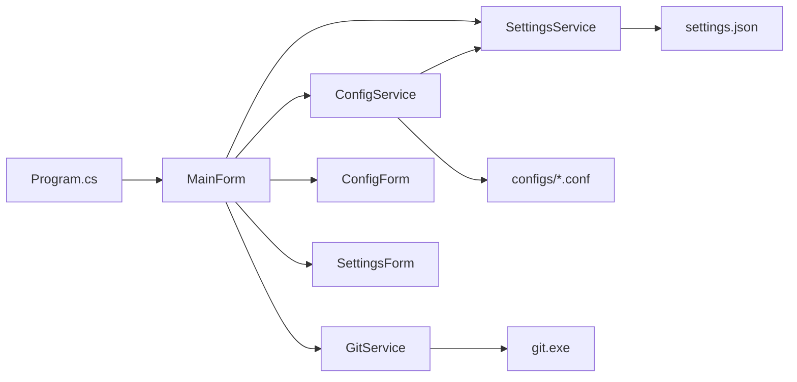
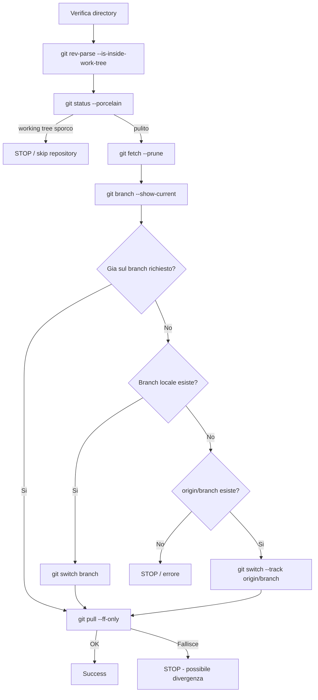
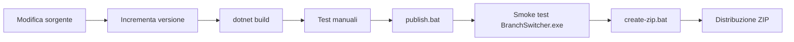

# BranchSwitcher - README Developer

## 1. Scopo del progetto

`BranchSwitcher` e un'applicazione desktop Windows sviluppata in **C# / .NET 8 WinForms** che consente di gestire rapidamente lo switch di branch Git su piu repository a partire da configurazioni riutilizzabili.

L'applicazione nasce per sostituire gli script Bash iniziali con una GUI distribuibile ai colleghi e indipendente dalla struttura locale delle cartelle.

Ogni utilizzatore configura una sola volta i path dei propri repository tramite la schermata **Impostazioni**. Le configurazioni operative, invece, sono salvate come file `.conf` e possono essere condivise, versionate e modificate anche manualmente.

---

## 2. Stack tecnologico

- **C#**
- **.NET 8**
- **Windows Forms (WinForms)**
- esecuzione dei comandi Git tramite `System.Diagnostics.Process`
- configurazione applicativa in JSON tramite `System.Text.Json`
- configurazioni branch in semplici file testuali `.conf`

Target del progetto:

```xml
<TargetFramework>net8.0-windows</TargetFramework>
<UseWindowsForms>true</UseWindowsForms>
<OutputType>WinExe</OutputType>
```

Versione attuale dichiarata nel progetto:

```text
2.2.1
```

---

## 3. Prerequisiti per lo sviluppo

Per compilare il progetto servono:

1. **Windows x64**;
2. **Git** installato;
3. **.NET 8 SDK** installato;
4. facoltativamente Visual Studio 2022 o Visual Studio Code.

### 3.1 Verifica Git

Da PowerShell:

```powershell
git --version
```

Esempio:

```text
git version 2.51.0.windows.1
```

### 3.2 Verifica .NET SDK

Eseguire:

```powershell
dotnet --list-sdks
```

Deve essere presente almeno un SDK `8.0.x`, ad esempio:

```text
8.0.4xx [C:\Program Files\dotnet\sdk]
```

Attenzione: avere installato solo il `.NET Runtime` non e sufficiente per compilare.

Con:

```powershell
dotnet --info
```

la sezione:

```text
.NET SDKs installed:
```

non deve riportare:

```text
No SDKs were found.
```

---

## 4. Struttura del repository

Struttura principale della versione v2:

```text
BranchSwitcher/
|
+-- BranchSwitcher/
|   +-- BranchSwitcher.csproj
|   +-- Program.cs
|   +-- MainForm.cs
|   +-- ConfigForm.cs
|   +-- SettingsForm.cs
|   +-- app.manifest
|   |
|   +-- Models/
|   |   +-- AppSettings.cs
|   |   +-- GitOperationResult.cs
|   |   +-- TaskEntry.cs
|   |
|   +-- Services/
|   |   +-- ConfigService.cs
|   |   +-- GitService.cs
|   |   +-- SettingsService.cs
|   |
|   +-- configs/
|   |   +-- TASK-101.conf
|   |   +-- TASK-202.conf
|   |
|   +-- settings.example.json
|
+-- configs/
|   +-- TASK-101.conf
|   +-- TASK-202.conf
|
+-- publish.bat
+-- create-zip.bat
+-- README-DEV.md
+-- user-guide.pdf
+-- docs/
|   +-- images/
|       +-- app-icon.png
+-- .gitignore
```

La directory `configs/` alla root e quella da utilizzare per il packaging/distribuzione. La cartella presente sotto `BranchSwitcher/` puo essere utilizzata in sviluppo come riferimento/esempio.

---

## 5. Architettura applicativa

L'applicazione e volutamente semplice e separa le responsabilita principali in tre servizi.



### 5.1 `Program.cs`

E il punto di ingresso dell'applicazione.

Responsabilita:

1. inizializza WinForms;
2. determina la directory dell'eseguibile tramite `AppContext.BaseDirectory`;
3. crea `SettingsService`;
4. crea `ConfigService`;
5. crea `GitService`;
6. avvia `MainForm`.

Estratto concettuale:

```csharp
var appDirectory = AppContext.BaseDirectory;
var settingsService = new SettingsService(appDirectory);
var configService = new ConfigService(appDirectory, settingsService);
var gitService = new GitService();

Application.Run(new MainForm(settingsService, configService, gitService));
```

Questo significa che i file esterni dell'app vengono risolti a partire dalla cartella in cui si trova `BranchSwitcher.exe`.

---

## 6. Modelli

### 6.1 `AppSettings`

Rappresenta il contenuto di `settings.json`.

Campi:

```csharp
public string ConfigsDirectory { get; set; } = "configs";
public string GitExecutable { get; set; } = "git";
public Dictionary<string, string> Repositories { get; set; }
```

Esempio JSON:

```json
{
  "ConfigsDirectory": "configs",
  "GitExecutable": "git",
  "Repositories": {
    "service-api": "C:\\Workspace\\MyWorkspace\\Core\\service-api",
    "shared-utils": "C:\\Workspace\\MyWorkspace\\Librerie\\shared-utils"
  }
}
```

### 6.2 `TaskEntry`

Record immutabile che rappresenta una singola associazione:

```text
repository -> branch
```

Esempio:

```text
service-api -> feature/TASK-101
```

### 6.3 `GitOperationResult`

Rappresenta l'esito dell'operazione Git su un repository:

- `Success`
- `Repository`
- `Branch`
- `Message`

---

## 7. `SettingsService`

File:

```text
Services/SettingsService.cs
```

Gestisce `settings.json` nella stessa directory dell'applicazione.

Il path e costruito con:

```csharp
Path.Combine(appDirectory, "settings.json")
```

### 7.1 Caricamento

Se `settings.json` non esiste, viene restituita una configurazione di default:

```text
ConfigsDirectory = configs
GitExecutable    = git
Repositories     = vuoto
```

Se il JSON non e leggibile o contiene un errore di deserializzazione, il servizio attualmente restituisce anch'esso `new AppSettings()`.

Questa scelta rende l'app robusta all'avvio, ma comporta che un `settings.json` corrotto venga trattato come configurazione vuota. Se in futuro si vuole maggiore diagnostica, questo e un buon punto da migliorare introducendo logging o messaggi di errore espliciti.

### 7.2 Salvataggio

Il file viene serializzato con indentazione tramite `System.Text.Json`.

---

## 8. `ConfigService`

File:

```text
Services/ConfigService.cs
```

Gestisce la directory delle configurazioni e i file `.conf`.

### 8.1 Directory configurazioni

Il path viene risolto con:

```csharp
Path.GetFullPath(Path.Combine(appDirectory, settings.ConfigsDirectory))
```

Con:

```json
"ConfigsDirectory": "configs"
```

si ottiene quindi:

```text
<directory applicazione>\configs
```

### 8.2 Formato `.conf`

Esempio:

```ini
# ============================================================
# TASK-101
# ============================================================

service-api=feature/TASK-101
shared-utils=develop
```

Regole di parsing:

- righe vuote ignorate;
- righe che iniziano con `#` ignorate;
- ogni riga attiva deve contenere `=`;
- la parte a sinistra e l'alias repository;
- la parte a destra e il branch;
- un errore di formato genera `FormatException` con file e numero di riga.

### 8.3 Elenco configurazioni

`GetAvailableTasks()`:

1. crea la directory `configs` se non esiste;
2. legge solo i file `*.conf` al primo livello;
3. rimuove l'estensione;
4. ordina alfabeticamente case-insensitive.

### 8.4 Salvataggio

`SaveTask()` genera automaticamente header/commenti e salva UTF-8 senza BOM.

Il nome viene validato come nome file Windows.

Se l'utente inserisce:

```text
TASK-101.conf
```

l'estensione viene rimossa e il file finale resta:

```text
TASK-101.conf
```

### 8.5 Eliminazione

`DeleteTask()` elimina fisicamente il file `.conf` corrispondente.

Non viene eseguita alcuna operazione Git sui repository associati.

---

## 9. `GitService`

File:

```text
Services/GitService.cs
```

E il componente piu delicato dell'applicazione.

Tutte le operazioni Git vengono lanciate come processi esterni senza apertura di console:

```csharp
UseShellExecute = false;
RedirectStandardOutput = true;
RedirectStandardError = true;
CreateNoWindow = true;
```

Gli argomenti vengono aggiunti tramite `ProcessStartInfo.ArgumentList`, evitando concatenazioni manuali del comando.

### 9.1 Sequenza completa

Per ogni repository:



### 9.2 Controllo working tree

Viene usato:

```bash
git status --porcelain
```

Se l'output non e vuoto, l'operazione viene bloccata.

Questo intercetta, tra le altre cose:

- file modificati;
- file staged;
- file cancellati;
- file untracked.

L'app non prova a correggere automaticamente la situazione.

### 9.3 Fetch

```bash
git fetch --prune
```

Aggiorna i riferimenti remoti e rimuove i riferimenti remoti non piu esistenti.

### 9.4 Switch

Se il branch esiste localmente:

```bash
git switch <branch>
```

Se esiste solo su `origin`:

```bash
git switch --track origin/<branch>
```

Se non esiste ne localmente ne su `origin`, il repository viene marcato in errore.

### 9.5 Pull

Dopo lo switch viene eseguito:

```bash
git pull --ff-only
```

`--ff-only` e intenzionale: impedisce al tool di creare merge commit automatici.

Se branch locale e remoto sono divergenti, l'operazione fallisce e viene richiesta gestione manuale.

### 9.6 Operazioni volutamente NON eseguite

Il tool non esegue automaticamente:

```text
git stash
git reset --hard
git clean
git merge
git rebase
git push
```

Questa e una scelta di sicurezza da preservare salvo requisito esplicito futuro.

---

## 10. `MainForm`

File:

```text
MainForm.cs
```

E la finestra principale.

Contiene:

- ComboBox `Configurazione`;
- campo `Ricerca`;
- `Aggiorna lista`;
- `Nuova configurazione`;
- `Elimina configurazione`;
- `Apri configs`;
- `Impostazioni`;
- `Avvia switch`;
- tabella repository/branch/stato;
- area log;
- label di stato.

### 10.1 Caricamento iniziale

All'evento `Shown`:

1. carica `settings.json`;
2. se non esistono repository configurati apre `Impostazioni`;
3. carica l'elenco delle configurazioni.

### 10.2 Ricerca configurazioni

`FilterTasks()` filtra `_allTasks` con:

```csharp
x.Contains(filter, StringComparison.OrdinalIgnoreCase)
```

La ricerca e quindi:

- immediata;
- parziale;
- case-insensitive.

### 10.3 Nomi lunghi

Sono presenti tre accorgimenti:

1. tooltip della ComboBox;
2. tooltip al mouse hover/focus;
3. larghezza della tendina calcolata dinamicamente fino a un massimo di 900 px.

### 10.4 Avvio switch

Prima di procedere viene mostrata una conferma.

Durante l'operazione i principali controlli vengono disabilitati per evitare operazioni concorrenti dalla GUI.

A fine elaborazione:

- viene aggiornato il log;
- viene aggiornato lo stato;
- viene ricaricata la tabella;
- viene mostrato un messaggio finale con esito.

---

## 11. `ConfigForm`

File:

```text
ConfigForm.cs
```

Gestisce la creazione di una configurazione direttamente dalla GUI.

L'utente inserisce:

- nome configurazione;
- uno o piu repository;
- un branch per ciascun repository.

La lista repository deriva dagli alias definiti in `settings.json`.

Validazioni:

- nome obbligatorio;
- almeno un repository;
- ogni riga deve avere alias e branch;
- lo stesso repository non puo comparire due volte;
- se la configurazione esiste gia, viene chiesta conferma prima di sovrascriverla.

Al salvataggio viene creato il file `.conf` tramite `ConfigService.SaveTask()`.

---

## 12. `SettingsForm`

File:

```text
SettingsForm.cs
```

Consente di modificare:

- percorso/comando Git;
- directory delle configurazioni;
- alias repository;
- path completo di ogni repository.

Il pulsante `Sfoglia...` usa `FolderBrowserDialog`.

### Convenzione sugli alias

Gli alias sono l'elemento che collega `settings.json` e i file `.conf`.

Esempio impostazioni:

```text
service-api -> C:\Workspace\MyWorkspace\Core\service-api
```

Esempio `.conf`:

```ini
service-api=feature/TASK-101
```

Gli alias devono quindi essere coerenti.

---

## 13. Esecuzione in sviluppo

Dalla root del progetto:

```powershell
dotnet run --project .\BranchSwitcher\BranchSwitcher.csproj
```

Oppure:

```powershell
cd .\BranchSwitcher
dotnet run
```

### Visual Studio

Aprire il progetto `BranchSwitcher.csproj`, quindi avviare con `F5`.

Per debug Git e consigliato usare repository di test, non repository di lavoro reali.

---

## 14. Build standard

Compilazione Release senza publish:

```powershell
dotnet build .\BranchSwitcher\BranchSwitcher.csproj -c Release
```

Output tipico:

```text
BranchSwitcher\bin\Release\net8.0-windows\
```

Questa modalita non e quella consigliata per distribuire l'app ai colleghi.

---

## 15. Publish Windows self-contained

Il repository contiene:

```text
publish.bat
```

Il comando centrale e:

```powershell
dotnet publish .\BranchSwitcher\BranchSwitcher.csproj `
  -c Release `
  -r win-x64 `
  --self-contained true `
  -p:PublishSingleFile=true `
  -p:IncludeNativeLibrariesForSelfExtract=true `
  -p:DebugType=None `
  -o .\publish
```

### 15.1 Significato opzioni

`-c Release`
: compila in modalita Release.

`-r win-x64`
: produce un'applicazione per Windows 64 bit.

`--self-contained true`
: include il runtime .NET necessario. Il PC destinatario non deve avere .NET installato.

`PublishSingleFile=true`
: produce l'applicazione in forma single-file per la parte eseguibile.

`IncludeNativeLibrariesForSelfExtract=true`
: include le librerie native richieste nel package single-file.

`DebugType=None`
: evita simboli di debug nel package finale.

### 15.2 Output atteso

Dopo il publish:

```text
publish/
+-- BranchSwitcher.exe
+-- configs/
+-- settings.example.json
+-- user-guide.pdf
```

Nota: `settings.json` non deve essere distribuito con path personali. Ogni utente lo genera tramite la GUI.

---

## 16. Documentazione e comportamento di `publish.bat`

La documentazione e separata in due livelli:

- `README-DEV.md`: documentazione tecnica destinata allo sviluppatore e mantenuta nel repository sorgente;
- `user-guide.pdf`: guida operativa destinata agli utilizzatori finali.

`publish.bat` considera `user-guide.pdf` parte obbligatoria del pacchetto. Prima di compilare verifica che il file sia presente nella root del progetto; se manca, il publish termina con errore.

Dopo una build riuscita copia automaticamente:

```text
configs/*.conf             -> publish/configs/
settings.example.json      -> publish/settings.example.json
user-guide.pdf             -> publish/user-guide.pdf
```

La parte rilevante dello script e:

```bat
if not exist "user-guide.pdf" (
  echo [ERRORE] File user-guide.pdf non trovato.
  exit /b 1
)

if not exist "publish\configs" mkdir "publish\configs"
if exist "configs\*.conf" copy /Y "configs\*.conf" "publish\configs\" >nul
if exist "BranchSwitcher\settings.example.json" copy /Y "BranchSwitcher\settings.example.json" "publish\settings.example.json" >nul
copy /Y "user-guide.pdf" "publish\user-guide.pdf" >nul
```

`README-DEV.md` non viene copiato nella cartella `publish`, perche contiene informazioni di sviluppo non necessarie agli utenti finali.

---

## 17. Creazione ZIP distribuibile

Il progetto contiene:

```text
create-zip.bat
```

Il flusso previsto e:

1. richiama `publish.bat`;
2. verifica l'esito;
3. comprime il contenuto di `publish/`;
4. genera:

```text
BranchSwitcher-Windows-x64.zip
```

Comando equivalente PowerShell:

```powershell
Compress-Archive -Path .\publish\* -DestinationPath .\BranchSwitcher-Windows-x64.zip
```

---

## 18. Package consigliato per gli utenti

Il package distribuito dovrebbe contenere solo quanto necessario:

```text
BranchSwitcher/
+-- BranchSwitcher.exe
+-- configs/
|   +-- eventuali configurazioni condivise.conf
+-- settings.example.json
+-- user-guide.pdf
```

Non distribuire:

```text
src/
bin/
obj/
README-DEV.md
*.pdb
settings.json personale
```

---

## 19. Test consigliati prima di una release

Prima di pubblicare una nuova versione eseguire almeno i seguenti casi.

### Impostazioni

- primo avvio senza `settings.json`;
- aggiunta repository;
- modifica path;
- path inesistente;
- Git non presente nel PATH;
- `GitExecutable` impostato con path esplicito.

### Configurazioni

- creazione config con un repository;
- creazione config con piu repository;
- nome lungo;
- sovrascrittura config esistente;
- eliminazione;
- ricerca;
- `Aggiorna lista` dopo aggiunta manuale di un `.conf`;
- `.conf` con commenti e righe vuote;
- `.conf` malformato.

### Git

- repository gia sul branch richiesto;
- switch verso branch locale;
- switch verso branch solo remoto;
- branch inesistente;
- working tree sporco;
- file untracked;
- `fetch` fallito;
- `pull --ff-only` riuscito;
- branch divergente con `pull --ff-only` fallito;
- path che non e un repository Git.

### GUI

- tooltip nome configurazione lungo;
- filtro configurazioni;
- lista vuota;
- log durante switch multiplo;
- pulsanti disabilitati durante l'esecuzione.

---

## 20. Versioning

La versione applicativa e attualmente dichiarata direttamente nel `.csproj`:

```xml
<Version>2.2.1</Version>
<AssemblyVersion>2.2.1.0</AssemblyVersion>
<FileVersion>2.2.1.0</FileVersion>
```

Per una nuova release aggiornare coerentemente i tre valori.

Esempio:

```xml
<Version>2.1.0</Version>
<AssemblyVersion>2.1.0.0</AssemblyVersion>
<FileVersion>2.1.0.0</FileVersion>
```

Schema suggerito: **Semantic Versioning**.

```text
MAJOR.MINOR.PATCH
```

Esempi:

- `2.0.1`: bugfix;
- `2.1.0`: nuova funzionalita retrocompatibile;
- `3.0.0`: modifica incompatibile significativa.

---

## 21. Punti di estensione futuri

La separazione attuale consente di evolvere il tool senza riscriverlo.

Possibili evoluzioni:

- modifica di una configurazione esistente dalla GUI;
- import/export configurazioni;
- gruppi/categorie di configurazioni;
- backup delle configurazioni;
- gestione remoti diversi da `origin`;
- scelta della strategia di aggiornamento;
- visualizzazione ahead/behind;
- pulsante per aprire il repository in Explorer/IDE;
- controllo aggiornamenti del tool;
- firma digitale dell'eseguibile;
- logging persistente su file;
- test automatici per `ConfigService` e `SettingsService`;
- astrazione del runner Git per rendere `GitService` unit-testable.

---

## 22. Considerazioni di sicurezza

Il tool esegue comandi Git sui repository locali dell'utente. Mantenere queste regole:

1. non fare reset automatici;
2. non cancellare file locali;
3. non fare stash automatici senza esplicito consenso;
4. non fare merge/rebase automatici;
5. non effettuare push;
6. bloccare lo switch se il working tree non e pulito;
7. usare `pull --ff-only`;
8. mostrare chiaramente errori e operazioni nel log.

Queste scelte riducono il rischio di perdita di lavoro o alterazioni non intenzionali della storia Git.

---

## 23. Troubleshooting sviluppo

### `No SDKs were found`

Problema:

```text
.NET SDKs installed:
  No SDKs were found.
```

Soluzione: installare **.NET 8 SDK x64**, non solo il runtime.

### `dotnet publish` non genera l'EXE

Eseguire manualmente:

```powershell
dotnet publish .\BranchSwitcher\BranchSwitcher.csproj -c Release -r win-x64 --self-contained true -p:PublishSingleFile=true -o .\publish
```

Leggere l'errore completo prima di controllare la directory `publish`.

### Git non trovato

Verificare:

```powershell
git --version
```

Oppure configurare in `GitExecutable` il path completo, ad esempio:

```text
C:\Program Files\Git\cmd\git.exe
```

### `settings.json` non viene salvato

Verificare che la directory in cui si trova `BranchSwitcher.exe` sia scrivibile dall'utente.

---

## 23.1 Manutenzione della guida utente

La guida distribuita e `user-guide.pdf`. Le immagini illustrative usate per la documentazione sono conservate in:

```text
docs/images/
```

Quando cambia in modo significativo la GUI o il comportamento operativo:

1. aggiornare il contenuto della guida;
2. aggiornare le immagini illustrative se necessario;
3. rigenerare `user-guide.pdf`;
4. aprire il PDF e verificare tutte le pagine;
5. eseguire `publish.bat`;
6. verificare che `publish/user-guide.pdf` sia presente;
7. eseguire `create-zip.bat` e verificare il contenuto dello ZIP.

La guida utente deve descrivere solo funzionalita realmente presenti nella release distribuita.

---

## 24. Flusso di release suggerito



Checklist rapida:

```text
[ ] sorgente compilabile
[ ] versione aggiornata
[ ] user-guide.pdf aggiornato e verificato
[ ] configs di esempio verificate
[ ] EXE avviato almeno una volta
[ ] test switch su repository di prova
[ ] ZIP finale verificato
[ ] settings.json personale escluso
```

---

## 25. Riepilogo tecnico

Il design e volutamente semplice:

```text
GUI
 |
 +-- SettingsService -> settings.json
 |
 +-- ConfigService   -> configs/*.conf
 |
 +-- GitService      -> git.exe
```

Le configurazioni dei repository sono specifiche del singolo utente, mentre le configurazioni task sono condivisibili.

Il tool automatizza esclusivamente operazioni Git conservative:

```text
status -> fetch -> switch -> pull --ff-only
```

senza modificare automaticamente il lavoro locale dell'utente.

---

## Icona applicativa

Dalla versione **2.2.1** l'icona dell'applicazione si trova in:

```text
BranchSwitcher/Resources/BranchSwitcher.ico
```

Il file `BranchSwitcher.csproj` la incorpora nell'eseguibile tramite:

```xml
<ApplicationIcon>Resources\BranchSwitcher.ico</ApplicationIcon>
```

Le finestre WinForms recuperano l'icona dall'eseguibile con `Icon.ExtractAssociatedIcon(Application.ExecutablePath)`, quindi non è necessario distribuire il file `.ico` separatamente.

La versione PNG utilizzata nella documentazione GitHub è:

```text
docs/images/app-icon.png
```

## Build automatica su GitHub

Il repository include:

```text
.github/workflows/build-windows.yml
```

La workflow usa `windows-latest`, installa il .NET 8 SDK, esegue il publish self-contained Windows x64, copia configurazioni e guida utente e genera `BranchSwitcher-Windows-x64.zip` come artifact GitHub Actions.

È possibile eseguirla manualmente dalla scheda **Actions** tramite `workflow_dispatch`, oltre all'esecuzione automatica su push e pull request verso `main`.

## Pubblicazione del sorgente su GitHub

La root del progetto e gia predisposta come repository GitHub. Contiene:

- `.gitignore` per escludere build, publish e settings locali;
- `README.md` come pagina principale del repository;
- `README-DEV.md` per gli sviluppatori;
- `user-guide.pdf` per gli utilizzatori;
- `.github/workflows/build-windows.yml` per la build automatica;
- `init-github.bat` per inizializzazione e primo push guidato.

Procedura consigliata:

1. creare su GitHub un repository **vuoto**;
2. non far generare a GitHub README, `.gitignore` o altri file iniziali;
3. eseguire dalla root:

```powershell
.\init-github.bat
```

4. inserire quando richiesto l'URL del repository remoto;
5. verificare il primo push sul branch `main`;
6. verificare nella scheda **Actions** l'esecuzione della workflow di build.

In alternativa e possibile usare i normali comandi `git init`, `git add`, `git commit`, `git remote add` e `git push` documentati nel `README.md` principale.
